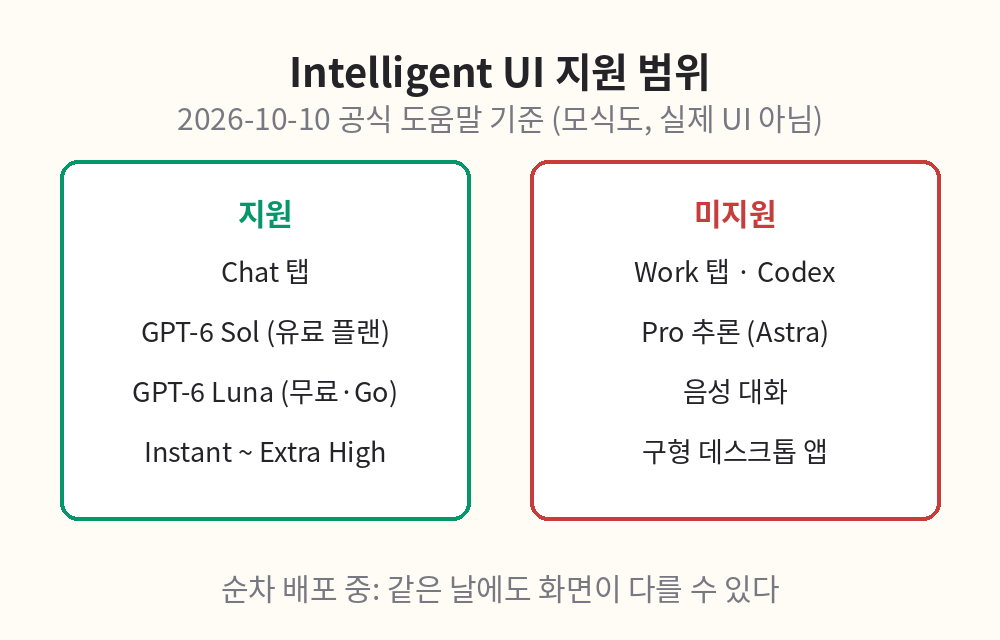

# 준비물·기능 확인

본격적인 실습 전에 준비물과 환경을 점검한다. 2장에서 자세히 다루지만, 시작 전에 한 번 훑어두면 실습이 수월하다.

## 준비물

- ChatGPT 계정 (무료 계정으로 시작 가능)
- 웹브라우저 (크롬, 엣지, 사파리 등 최신 버전)
- 메모장이나 노트 앱 (실습 결과 기록용)
- 계산기 앱 (5장의 검산용)

## 기능 확인 (요약)

Intelligent UI는 2026년 10월 7일 유료 플랜부터, 10월 8일 무료·Go 플랜부터 순차 배포됐다. 다음 조건을 확인한다.

- Chat 탭에서 사용할 것 (Work 탭, Codex, 음성 대화에서는 미지원)
- 적용 모델: 유료 플랜은 GPT-6 Sol, 무료·Go 플랜은 GPT-6 Luna
- 설정 범위: Instant부터 Extra High까지 (Pro 추론 Astra에서는 미지원)

위 조건은 2026-10-10 공식 도움말 기준이며 변경될 수 있다. 자세한 확인 절차와 지원되지 않을 때의 대안은 2장을 참고한다.

위 그림은 지원 범위를 정리한 모식도이며 실제 UI 화면이 아니다.
